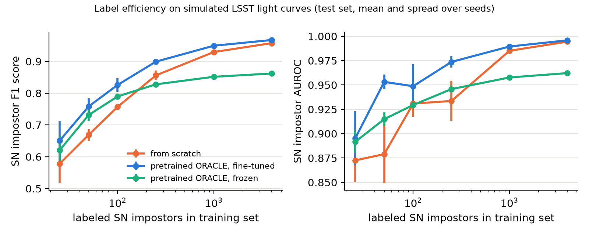

# lsst-impostor-search

[](LICENSE)
[](https://www.python.org/)
[](https://doi.org/10.71929/rubin/3382528)

Tools to find **eruptive massive stars** (supernova impostors and luminous blue variable eruptions) in Rubin Observatory / LSST data, and to measure how often they erupt.

These stars brighten by several magnitudes in non-terminal eruptions and survive. Only a few dozen are known. Rubin's wide, deep, multi-band coverage makes a systematic search possible for the first time.

> **Status: early development.** The DP2 candidate search is functional; the machine-learning part is a prototype tested on simulated data only.

## What is in this repository

| Folder | What it does | Where it runs |
|---|---|---|
| [`rsp_search/`](rsp_search/) | Candidate search of Rubin Data Preview 2 (DP2): selects variable sources, assigns host galaxies and distances from HECATE, and retrieves forced-photometry light curves. Python package `impostorsearch` plus notebooks. | Rubin Science Platform |
| [`ml/`](ml/) | Machine-learning prototype: fine-tunes the pretrained ORACLE light-curve classifier to recognize simulated eruptions and compares it with training from scratch. The pretrained ORACLE weights are downloaded automatically from the ORACLE repository. | Laptop or GPU cluster (UVA Rivanna) |

Each folder has its own README with instructions.

## First result: transfer learning needs fewer labeled eruptions

Fine-tuning the pretrained ORACLE classifier ([Shah et al. 2025](https://doi.org/10.3847/1538-4357/ae1130)) on simulated LSST light curves finds more eruptions than the same network trained from scratch, most clearly when labeled examples are scarce: it reaches the same recall with about half as many labeled SN impostors. With 50 labeled SN impostors, it recovers 61% of SN impostors in a held-out test set, compared with 50% from scratch (with 25: 49% versus 41%). Before fine-tuning, ORACLE, which has no class for recurring eruptions, spreads the simulated eruptions across long-duration transients, AGN, and periodic variables.



*SN impostor F1 score and AUROC versus the number of labeled SN impostors, for three ORACLE-architecture networks: trained from scratch, pretrained and fine-tuned, and pretrained with the encoder frozen. Mean and spread over three seeds; test set of 1,500 objects per class. Run on one NVIDIA RTX A6000 GPU on UVA's Rivanna cluster (34 minutes). These are simulated data, so the numbers test the method, not survey performance.*

## Quick start

**Candidate search (on the Rubin Science Platform):** requires a Rubin Science Platform account (Rubin data rights).

```bash
git clone https://github.com/Aghakhanloo/lsst-impostor-search.git
pip install --user -e lsst-impostor-search/rsp_search
```

Then open the notebooks in `rsp_search/notebooks/`.

**ML prototype (on a GPU cluster):**

```bash
git clone https://github.com/Aghakhanloo/lsst-impostor-search.git
cd lsst-impostor-search
sbatch ml/rivanna_job.slurm
```

## Contact

Mojgan Aghakhanloo, University of Virginia: [mojgan.aghakhanloo@virginia.edu](mailto:mojgan.aghakhanloo@virginia.edu). Questions and bug reports are welcome as [GitHub issues](https://github.com/Aghakhanloo/lsst-impostor-search/issues).

## Citation

If you use this code, please cite it via `CITATION.cff` (Zenodo DOI to be added) and:

- Kovlakas, K., et al. 2021, MNRAS, 506, 1896 (HECATE): [https://doi.org/10.1093/mnras/stab1799](https://doi.org/10.1093/mnras/stab1799)
- Shah, V. G., et al. 2025 (ORACLE): [https://doi.org/10.3847/1538-4357/ae1130](https://doi.org/10.3847/1538-4357/ae1130), [arXiv:2501.01496](https://arxiv.org/abs/2501.01496)
- NSF-DOE Vera C. Rubin Observatory 2026, Legacy Survey of Space and Time Data Preview 2, [doi:10.71929/rubin/3382528](https://doi.org/10.71929/rubin/3382528)

## Acknowledgments

This work uses data from the NSF-DOE Vera C. Rubin Observatory Legacy Survey of Space and Time, Data Preview 2 ([doi:10.71929/rubin/3382528](https://doi.org/10.71929/rubin/3382528)), accessed through the Rubin Science Platform. The candidate search was developed at the LSST Catalyst Symposium. Host galaxies come from the HECATE catalog ([Kovlakas et al. 2021](https://doi.org/10.1093/mnras/stab1799)), retrieved through [VizieR](https://vizier.cds.unistra.fr) (CDS, Strasbourg). The ML prototype builds on the public ORACLE model ([Shah et al. 2025](https://doi.org/10.3847/1538-4357/ae1130)) and runs on the University of Virginia's [Research Computing](https://www.rc.virginia.edu) clusters. This code uses [Astropy](https://www.astropy.org), NumPy, Matplotlib, and PyTorch.

## License

BSD 3-Clause. See [`LICENSE`](LICENSE).
