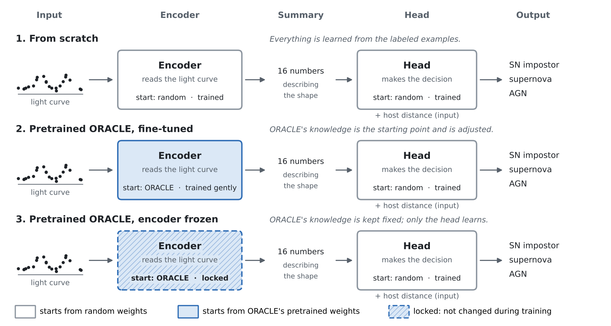

# Machine-learning prototypes for finding SN impostors

Two experiments on **simulated** LSST-like light curves. Simulated performance is an upper limit on real-data performance; the point is a working, reproducible setup that carries over to real LSST data.

1. **Transfer learning (main experiment).** Starts from ORACLE-1, a public classifier pretrained on simulated LSST alerts, and fine-tunes it to recognize SN impostors. It measures how many labeled SN impostors are needed, compared with training from scratch.
2. **Baseline: a transformer trained from scratch** (`baseline/`). Includes calibration with a deep ensemble.

## The simulated data (`simulate.py`)

g, r, i light curves on an LSST-like cadence (two 180-day seasons, about one visit per band every 8 days, sky-dominated noise) for three classes:

- **SN impostor:** an LBV-like star with S Dor-like variability (0.1 to 2 mag over years to decades, redder when brighter; [van Genderen 2001](https://www.aanda.org/articles/aa/full/2001/05/aads1896/aads1896.orig.html)), plus either recurring periastron-triggered outbursts (70%) or a single long giant eruption (30%). The outbursts are modeled on SN 2000ch and AT 2016blu: period 40 to 400 d, amplitude 1 to 3.5 mag, irregular multi-peaked shapes.
- **sn:** Ia-like, II-like, and slow IIn-like supernovae (the hardest to separate from giant eruptions).
- **agn:** background quasars seen through the host, with damped-random-walk variability.

Each object sits in a host galaxy at 5 to 40 Mpc. The classifier also receives the median absolute magnitude computed from the host distance, as the real search gets from HECATE. Only objects that would be detected in difference imaging are kept.

To see what the simulated light curves look like, run `python ml/plot_examples.py` (saves `ml/example_lightcurves.png`; use `--seed` for other examples).

## 1. Transfer learning from ORACLE (`finetune_experiment.py`)

ORACLE-1 ([Shah et al. 2025](https://doi.org/10.3847/1538-4357/ae1130)) is a recurrent network trained on about 0.5 million simulated LSST alert light curves (ELAsTiCC) to classify 19 transient and variable classes. It has no SN impostor or LBV class. `oracle_transfer.py` rebuilds its light-curve-only network layer by layer, loads the public weights, converts the simulations to its input format (difference-image flux, error, band wavelength, detection flag, time), and adds a new three-class head that also receives the host distance.

For each number of labeled SN impostors N (25, 50, 100, 250, 1000, 4000), with 4000 supernovae and 4000 AGN, the same network is trained three ways:

| Mode | Starting weights | What is trained |
|---|---|---|
| from scratch | random | everything |
| pretrained, fine-tuned | ORACLE-1 | everything (smaller learning rate for the encoder) |
| pretrained, frozen | ORACLE-1 | only the new head |



*The network has two parts: an encoder that reads the light curve and summarizes its shape in 16 numbers, and a head that makes the decision using that summary plus the host distance. The three modes differ only in how the encoder starts and whether it is allowed to change. The head is always new, because ORACLE's original head was built for its own classes.*

Every configuration is repeated with three seeds and evaluated on one fixed test set of 1500 objects per class. The script also records what the original ORACLE calls the simulated objects before fine-tuning ("zero-shot"). It has no SN impostor class, so this shows how a general-purpose classifier would label them.

**Run on UVA's HPC (Rivanna/Afton).** Edit the allocation line in `ml/rivanna_job.slurm`, then from the repository folder:

```bash
sbatch ml/rivanna_job.slurm
```

It uses UVA's PyTorch container and downloads the ORACLE weights (`ml/get_oracle_weights.sh`, checksum verified). It takes about 1 to 2 hours on one GPU.

**Run on a laptop (small version):**

```bash
pip install -r ml/requirements.txt
bash ml/get_oracle_weights.sh
python ml/finetune_experiment.py --counts 25 100 1000 --seeds 2 --steps 600 --out ml/results_transfer_small
```

Outputs in `--out`:

| File | Contents |
|---|---|
| `label_efficiency.png` | SN impostor F1 and AUROC versus number of labeled SN impostors, per mode |
| `results.csv` | every run: mode, N, seed, recall, precision, F1, AUROC, training time |
| `summary.json` | mean and spread per mode and N, zero-shot ORACLE calls, hardware |

## 2. Baseline: transformer from scratch, with calibration (`baseline/train.py`)

A transformer reads each observation as a token, with a band embedding and a time encoding (`baseline/model.py`). It is evaluated with a confusion matrix, SN impostor recall versus outburst amplitude and host distance, and calibration of a single model versus a deep ensemble.

```bash
python ml/baseline/train.py --n-per-class 5000 --epochs 15 --ensemble 1 --out ml/baseline/results_small   # laptop
python ml/baseline/train.py --n-per-class 50000 --epochs 30 --ensemble 5 --device cuda --out ml/baseline/results         # one GPU
```

## Limitations

- **The simulations leave out many real effects:** other variable classes, extinction, image artifacts, the true LSST cadence and depth variations, and the full diversity of eruptions.
- **The SN impostor model is built on a handful of well-studied objects.**
- **The domain gap is deliberately not removed.** ORACLE was trained on six-band light curves of mostly distant transients; these are three-band and nearby.

Read the results as a test of the method, not as survey predictions.

## Next steps

- **Real LSST cadence.** Replace the simplified cadence in `simulate.py` (two 180-day seasons with random gaps) with Rubin's simulated observing schedule (the OpSim baseline used in [PSTN-054](https://pstn-054.lsst.io/PSTN-054.pdf)): take the actual visit times, filters, and depths at random positions in nearby galaxies. This captures season lengths that depend on position on the sky, gaps from weather and the Moon, and the rolling cadence. Once LSST data are available, use the real visit history from the Rubin data releases instead.
- **Expert-simulated contaminants from ELAsTiCC.** Replace the simple supernova and AGN models with the public [ELAsTiCC](https://portal.nersc.gov/cfs/lsst/DESC_TD_PUBLIC/ELASTICC/) light curves from LSST DESC (supernovae, AGN, and other look-alikes such as ILOTs, CaRTs, TDEs, and SLSNe), which already use Rubin's simulated cadence. ELAsTiCC has no SN impostor class, so SN impostors still come from `simulate.py`, injected with the visit times and depths of real ELAsTiCC objects so the classifier cannot tell the two simulators apart. Keep the IIn-like model if SNe IIn are not available as a separate class. Because ORACLE was pretrained on ELAsTiCC, the pretrained model starts with an advantage on these contaminants; report this alongside the comparison.

## Credits

ORACLE-1: Shah, V. G., Gagliano, A., Malanchev, K., Narayan, G., & LSST DESC 2025, [doi:10.3847/1538-4357/ae1130](https://doi.org/10.3847/1538-4357/ae1130), [arXiv:2501.01496](https://arxiv.org/abs/2501.01496). The weights are downloaded from [github.com/dev-ved30/Oracle](https://github.com/dev-ved30/Oracle) under its license and are not redistributed here.

## Tests

```bash
pytest ml/tests
```
